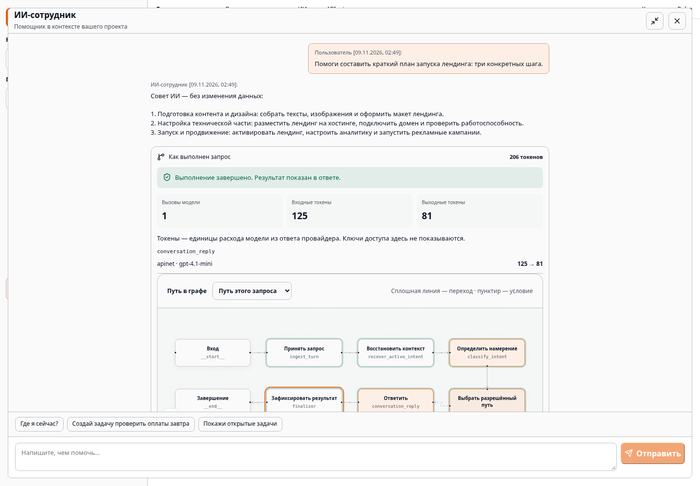

# Как устроен управляемый ИИ-сотрудник

Pulse использует модель для понимания запроса и подготовки ответа. Полномочия
остаются у Go API: модель не получает SQL, shell, доступ к файлам сервера или
произвольный HTTP-инструмент. Пользователь видит предложение до изменения данных.

## Путь запроса

1. React отправляет сообщение с контекстом открытой страницы через HTTP API.
2. Go проверяет сессию, проект и состояние сотрудника. Контекст интерфейса —
   подсказка, а не источник полномочий.
3. Go вызывает Python `StartTurn` по gRPC. LangGraph проходит заданные узлы:
   `ingest_turn → recover_active_intent → classify_intent → proposal_gate`.
4. Выбранная ветка читает данные через `ToolGateway` и готовит карточку инструмента.
   Каталог задаёт имя, входной контракт, риск и необходимость подтверждения.
5. Для изменения данных `await_approval` сохраняет checkpoint и вызывает `interrupt`.
   Состояние «ожидает человека» означает, что команда ещё не применена.
6. Человек редактирует карточку, подтверждает или отклоняет её. Go повторно проверяет
   актуальные права и политику сотрудника, блокирует предложение и выполняет доменную команду.
7. Результат и события фиксируются в одной транзакции. Кнопка подтверждения
   продолжает checkpoint через `ResumeTurn`. Сообщение «Да, создавай» проходит
   новый `StartTurn` и зарегистрированную ветку `approval_decision` для активного
   предложения; права и транзакционная команда остаются теми же.
   Повторное подтверждение возвращает сохранённый результат без повторного создания объекта.

Граф на [`/tech`](https://pulse.riders.agency/tech#agent-runtime) строится из
[экспорта скомпилированного LangGraph](../apps/ai-agent/src/pulse_agent/export_graph.py).
Это действительная топология, а не вручную нарисованная схема. В чате виден путь
конкретного запроса; на технической странице можно изучить все ветки и инструкции узлов.

## Инструкции и права — разные механизмы

[Узлы графа](../apps/ai-agent/src/pulse_agent/graph/builder.py) и их переходы заданы кодом.
Классификатор выбирает предусмотренный маршрут; сам текст пользователя не может
добавить узел или зарегистрировать инструмент. Python проверяет структуру карточек,
Go проверяет каталог и доменные условия. Свободный ответ модели всё ещё может ошибиться;
проверки ограничивают действия, а не гарантируют истинность любого текста.

[Политика сотрудника](../apps/api/internal/modules/ai/tools/employee_policy.go)
может только сузить доступный каталог:

```json
{
  "allowed_tools": ["client.search", "task.search", "task.create"],
  "denied_tools": ["client.create"],
  "write_requires_approval": true,
  "critical_requires_elevated_approval": true
}
```

Пустой `allowed_tools` запрещает все инструменты. Отсутствие списка сохраняет
доступ к зарегистрированному каталогу в пределах прав пользователя. Запрет имеет
приоритет. Политику меняет администратор проекта; отключённый или архивный сотрудник
не исполняет запрос. Отключение подтверждения записи запрещено сервером. Риск,
присланный вызывающей стороной, не может понизить риск из каталога.

Это отличается от выдачи кодирующему агенту широкого доступа к среде разработки:
в Pulse сотрудник получает ограниченный набор бизнес-действий и контекст конкретного
пользователя. Само название агента или формулировка prompt не являются защитой.

## Авторизация

- **Браузер:** серверная сессия, HttpOnly cookie и CSRF для изменений. При истечении
  сессии интерфейс возвращает рабочую форму входа; обновление сессии объединяет
  параллельные запросы и не повторяется бесконечно.
- **API-ключ:** явные grants компании, проекта или сценария и разрешённые операции.
  Ключ проекта не получает право менять компанию. Право чтения не означает право записи.
- **Пользователь:** проверяются активное членство, роль и доступ к объекту. Аудитор
  читает разрешённые данные, но не изменяет их. Процесс задач имеет дополнительные
  роли и правила переходов.
- **gRPC:** внутренний сервис аутентифицируется отдельно; контекст делегированной
  операции содержит компанию, проект, пользователя и запрос. Внешний клиент не
  может просто подставить эти поля и получить права.
- **Подтверждение:** проверяется создатель сессии, текущая роль, состояние предложения
  и текущий allowlist. Действие выполняется под правами пользователя, а не общей
  привилегией модели.

Реализация: [authz](../apps/api/internal/platform/authz),
[проверка инструментов](../apps/api/internal/modules/ai/tools/policy_gateway.go),
[атомарное подтверждение](../apps/api/internal/modules/ai/service/approval.go).

## Расход модели и журнал выполнения

Python обращается к Go `ModelGateway`, а Go — к APInet. Ключ провайдера не передаётся
в браузер или в Python. В ответе «Как выполнен запрос» показаны:

- пройденные узлы и длительность шагов;
- имена инструментов и их состояния;
- провайдер, модель и число успешных вызовов;
- входные и выходные токены из `usage` ответа провайдера;
- остановка перед подтверждением или завершение.

Это токены расхода модели, не секретные ключи. Счётчики не рассчитываются по длине
текста; ветка без модели показывает «Без вызова модели». Они ограничены текущим
запросом. Поставщик может не вернуть usage или не вернуть ответ на неуспешный вызов:
такие расходы нельзя восстановить из клиентского журнала, окончательный биллинг
остаётся у провайдера. Денежная стоимость не выдумывается из количества токенов.

Трассировка ограничена по размеру, проходит типизированный allowlist в Go и
не содержит prompt, ключи или необработанный ответ модели. Перезагрузка чата
восстанавливает сохранённую трассировку. Протокол SSE отдельно передаёт текущее состояние.



## Надёжность и демонстрация

Checkpoint Python хранит состояние диалога, а PostgreSQL Go — бизнес-результат.
Транзакция и outbox не позволяют получить задачу без записи подтверждения.
Ошибка команды откатывает её изменения; отказ человека не запускает её.
Тест восьми параллельных подтверждений проверяет один созданный объект.

Публичное демо использует вымышленные данные, отдельные проекты гостей и лимиты
модели. Внешние отправки закрыты. Подключение конкретного банка требует отдельного
адаптера и серверных реквизитов: [границы банковского интерфейса](BANK_INVOICES.md).

Прокси-заголовки IP принимаются только от настроенного доверенного узла.
Решение учитывает [рекомендации chi](https://github.com/go-chi/chi/blob/master/middleware/realip.go);
исходный адрес TCP-соединения сохраняется. Для gRPC используется `NewClient`
с ограниченным ожиданием готовности согласно [контракту grpc-go](https://github.com/grpc/grpc-go/blob/master/clientconn.go).
