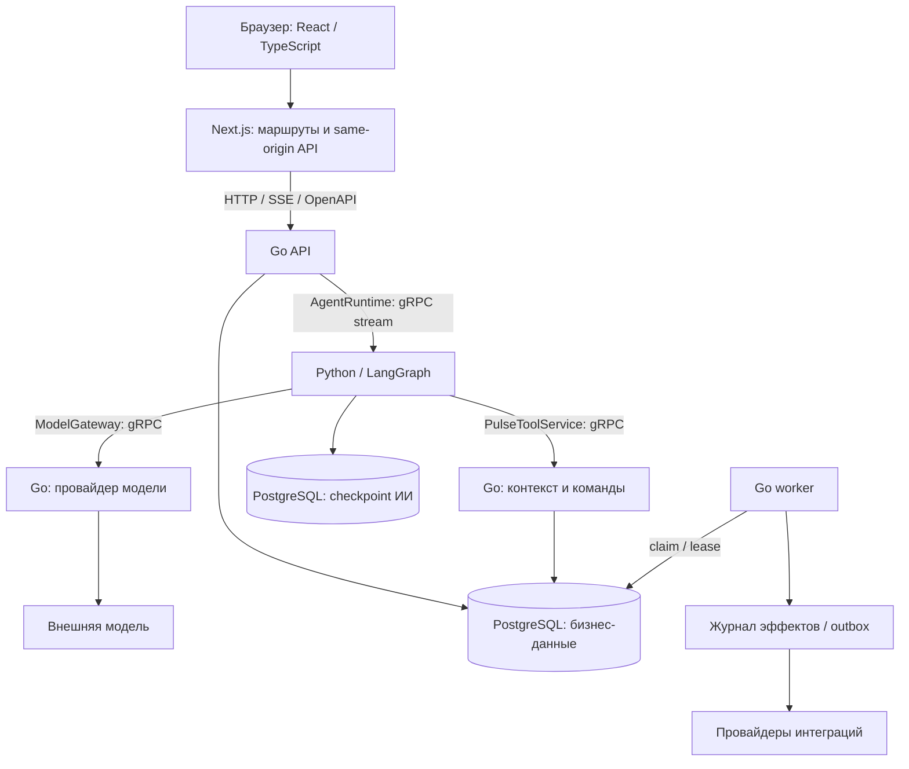
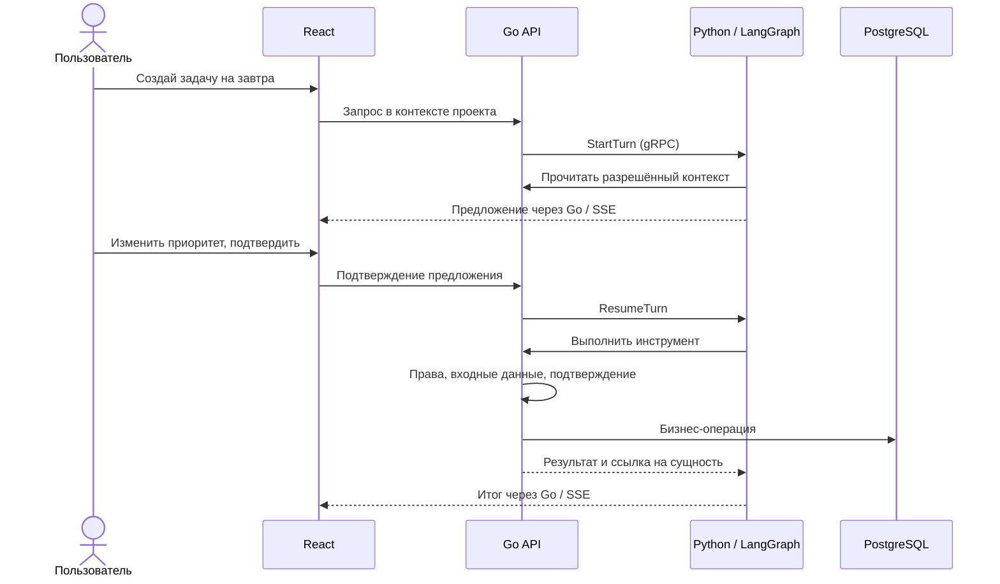

# Как построен Pulse

Pulse — модульный Go-монолит с отдельными процессами API и worker,
веб-интерфейсом Next.js и Python-сервисом ИИ. Основное хранилище — PostgreSQL.
Это позволяет проводить бизнес-операции в одной транзакции, отдельно запускать
обработку сценариев и менять ИИ-оркестратор без переноса прав доступа в промпты.

## Процессы и контракты

Стрелки отражают логические границы. Go-шлюзы используют тот же код приложения;
это не отдельные микросервисы с собственными базами. Redis, Kafka и Kubernetes
не являются обязательными компонентами базового запуска.

## Фронтенд: React, Next.js и TypeScript

Маршруты App Router находятся в `apps/web/src/app`, продуктовые области —
в `src/features`. Страница собирает экран, feature-компоненты владеют его
взаимодействиями, общие API- и UI-модули обеспечивают единое поведение.
Публичная `/tech` рендерит описание на сервере; переключатель записей —
клиентский компонент. Рабочие экраны используют клиентское состояние там,
где нужны редактор, чат, подписки и формы.

- **Состояние:** Zustand хранит рабочий контекст и настройки оболочки;
  локальное состояние — ввод и взаимодействия конкретного экрана.
- **API:** типы генерируются из OpenAPI. Общий транспорт задаёт тайм-аут,
  отмену и обработку ошибок. По умолчанию повторяются безопасные чтения,
  а не произвольные команды записи.
- **Сессия:** cookie-сессия, CSRF и объединение одновременных запросов обновления.
  Сохраняется совместимость с прежним bearer-token: поле token ещё есть в
  persisted store. Полный отказ от старого механизма не заявляется.
- **Асинхронность:** область запроса связывает ответ с текущим диалогом/проектом;
  отмена и проверка актуальности предотвращают применение устаревших результатов.
- **UI:** локальные примитивы, Radix Dialog, Lucide, CSS с общей палитрой;
  XYFlow отвечает за редактор графов. Tailwind не является основой текущей сборки.
- **UX:** загрузка, отсутствие данных, ошибка и повторная попытка — состояния
  экрана. Черновик чата сохраняется при сбое; удаление задач обратимо.

Исходники: [HTTP-транспорт](../apps/web/src/lib/api/http-transport.ts),
[сессия](../apps/web/src/lib/api/http-browser-session.ts),
[область запроса ИИ](../apps/web/src/features/ai-employee/hooks/useAIEmployeeRequestScope.ts).

## Go: модули, права и транзакции

`cmd/api` и `cmd/worker` — точки запуска. Сборка приложения в `internal/platform/app`
передаёт зависимости модулям. HTTP на chi ведёт к сервисным операциям; репозитории
используют pgx. OpenAPI описывает внешнюю HTTP-границу, protobuf — связь с Python.

Основные области: auth, companies/projects, worktracker, clients, workflows,
runs, providers, sitechat и ai. Общая платформа содержит авторизацию, SQL,
криптографию, outbox и вспомогательные механизмы. Runtime исполняет граф,
но не должен становиться вторым владельцем правил каждого домена.

Показательный пример — [архивирование задачи](../apps/api/internal/modules/worktracker/service/task_archive.go):

1. Проверка пользователя и доступа к проекту.
2. Начало транзакции и `SELECT … FOR UPDATE` по задаче.
3. Повторная проверка прав на зафиксированном состоянии и запрет удаления
   при активном/приостановленном таймере.
4. Обновление архива и версии, запись события в той же транзакции.
5. Commit; при ошибке — rollback. Повтор уже выполненного действия не дублирует историю.

Блокировка нужна из-за гонки удаления и запуска таймера: одной предварительной
проверки вне транзакции было бы недостаточно. Это проверяют интеграционные тесты.
`platform/uow` объединяет составные команды и outbox в одной транзакции.
Модули меняют свои таблицы через команды владельца; межмодульные чтения используют
явные версионированные read-контракты. [Решение и проверка границ](architecture/controlled-module-boundaries.md).

## Python: управляемый ИИ-сотрудник

LangGraph описывает состояния и переходы: получение запроса, восстановление
намерения, классификация, чтение контекста, предложение, ожидание подтверждения,
возобновление и завершение. Pydantic валидирует структуры на стороне Python.
Checkpoint в PostgreSQL хранит состояние оркестрации отдельно от бизнес-операций.

`AgentRuntime` предоставляет `StartTurn`, `ResumeTurn`, `CancelRun`,
`GetThreadState`. Поток `AgentEvent` передаёт промежуточные события интерфейсу.
В protobuf заданы идентификаторы компании, проекта, пользователя, запроса
и трассировки; расширяемые payload используют `google.protobuf.Struct`.
Не каждый внутренний JSON автоматически становится строго типизированным.

Python не получает прямой доступ к бизнес-таблицам или ключам модели.
Чтение и изменение проходят через Go-инструменты. Вывод модели, страница
и пользовательский текст не дают дополнительных прав. Записанный сценарий
создания задачи использует детерминированный разбор; это отдельно отмечено
в интерфейсе, чтобы не выдавать его за демонстрацию внешней LLM.

## Worker: конкуренция, повторы и неопределённость

- **Опубликованный граф:** запуск фиксирует версию сценария.
- **Получение работы:** `FOR UPDATE SKIP LOCKED` распределяет задания между
  исполнителями без ожидания занятой строки.
- **Lease:** право выполнения ограничено во времени. Fencing token меняется
  при новом захвате; соответствующие записи проверяют владельца/поколение.
- **Отключённый шаг:** пропускается до провайдера, причина остаётся в журнале.
- **Outbox:** исходящие события имеют состояние, аренду, обработчик и повторы.
- **Журнал эффектов:** фиксирует `started`, `succeeded`, `failed`, `unknown`
  и ключ операции. После тайм-аута внешний эффект может уже существовать.

Здесь нет универсальной гарантии «ровно один раз» для стороннего API.
Без поддержки ключа идемпотентности или поиска операции у провайдера повтор
может быть опасен. Журнал применяется к предусмотренным интеграциям; нельзя
автоматически распространить эту гарантию на любой старый обработчик.

Исходники: [claim](../apps/api/internal/runtime/kernel/claim.go),
[effect ledger](../apps/api/internal/runtime/effects/ledger.go),
[outbox](../apps/api/internal/platform/outbox/worker.go).

## Данные, финансы и секреты

PostgreSQL хранит бизнес-сущности, версии сценариев, задания и журналы.
Миграции после публичного baseline добавляются последовательно; baseline
предназначен только для пустой базы. Он содержит схему и общие каталоги действий,
без переноса рабочих компаний, пользователей и оплат.

Банковский черновик использует ожидаемую ревизию и ключ идемпотентности.
Сервер получает сумму и валюту из оплаты и отдельно проверяет финансовые права.
Контракт `Create`/`Lookup` оставляет место для сверки операции после потери ответа;
конкретный банковский адаптер ещё нужно реализовать.

Секреты провайдеров шифруются AES-GCM; основной ключ приходит из окружения.
Проверки конфигурации production отличаются от допустимых локальных режимов.
Наличие gRPC само по себе не означает TLS: транспорт и внутренние токены
настраиваются явно, локальный insecure-режим не является схемой для открытой сети.

## Наблюдаемость и проверяемость

Идентификаторы запроса/трассировки связывают события. Python фиксирует причину
решения, источник разбора и длительности; Go хранит выполнение шагов и эффектов.
Есть инструменты для OpenTelemetry, но готовый внешний сборщик и единая
production-панель этой публикацией не подтверждены.

Локальная проверка включает типы, контракты, unit/integration, race и браузерные
сценарии. GitHub используется как хранилище: Actions отключены. Это не отменяет
проверок перед публикацией и не делает известные ошибки незаметными.

## Проверяемые границы

Проверка модулей проходит без исключений: запись принадлежит владельцу данных,
составные команды используют общую транзакцию, межмодульные списки и отчёты —
версионированные контракты чтения. Это модульный монолит с одной базой PostgreSQL.
[Принятое решение](architecture/controlled-module-boundaries.md) описывает его
преимущества и ограничения при будущем разделении на сервисы.

Браузер сохраняет только маркер cookie-сессии и настройки интерфейса; секретные
bearer-токены исключены из постоянного хранилища и URL WebSocket.
Банковский интерфейс имеет контракт адаптера и сохраняет черновики; выбранный
банк подключается отдельно. [Функциональные границы](LIMITATIONS.md).

## Контроль сотрудника

[Права, LangGraph, human-in-the-loop, реальные токены и защита от повторов](AI_CONTROL.md).
